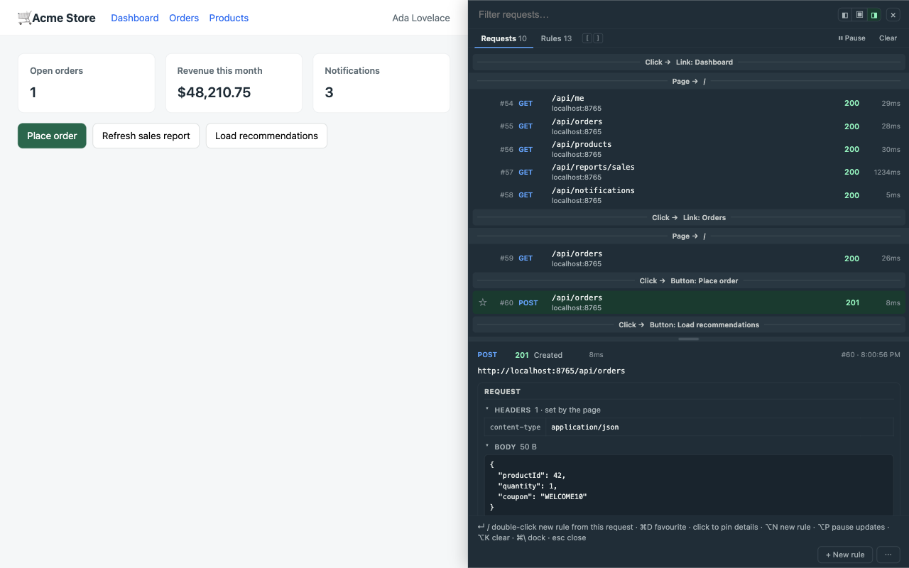
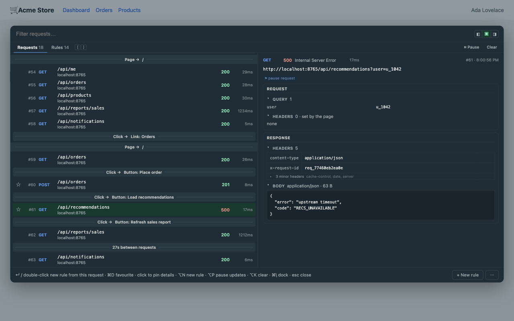
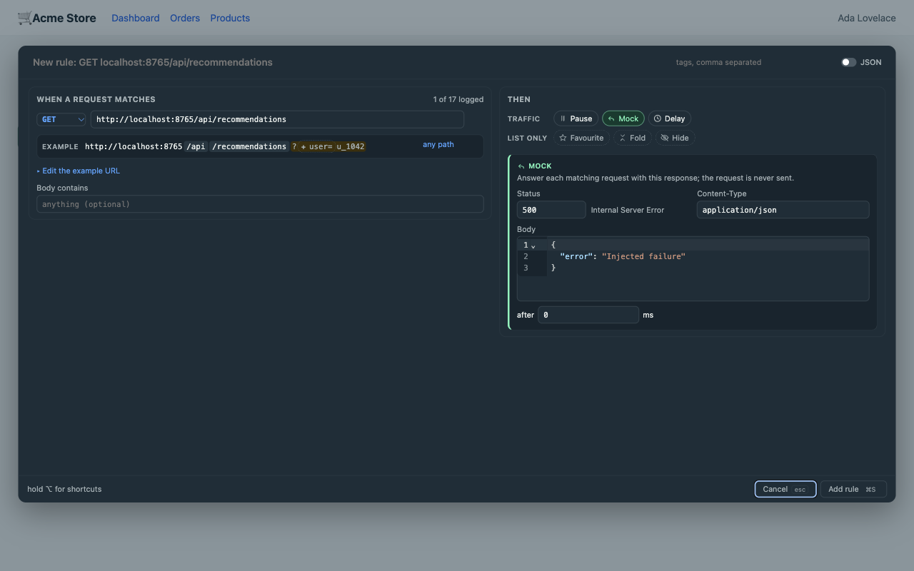
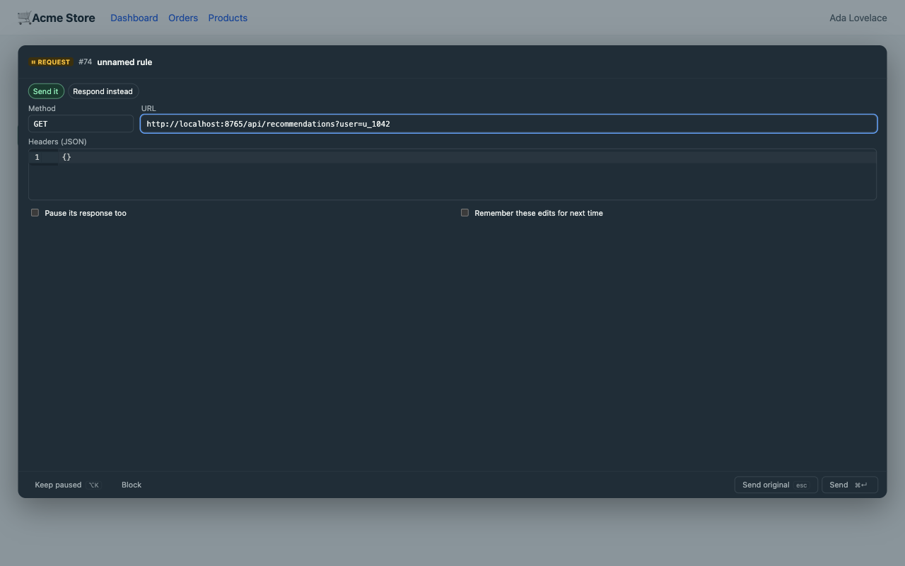
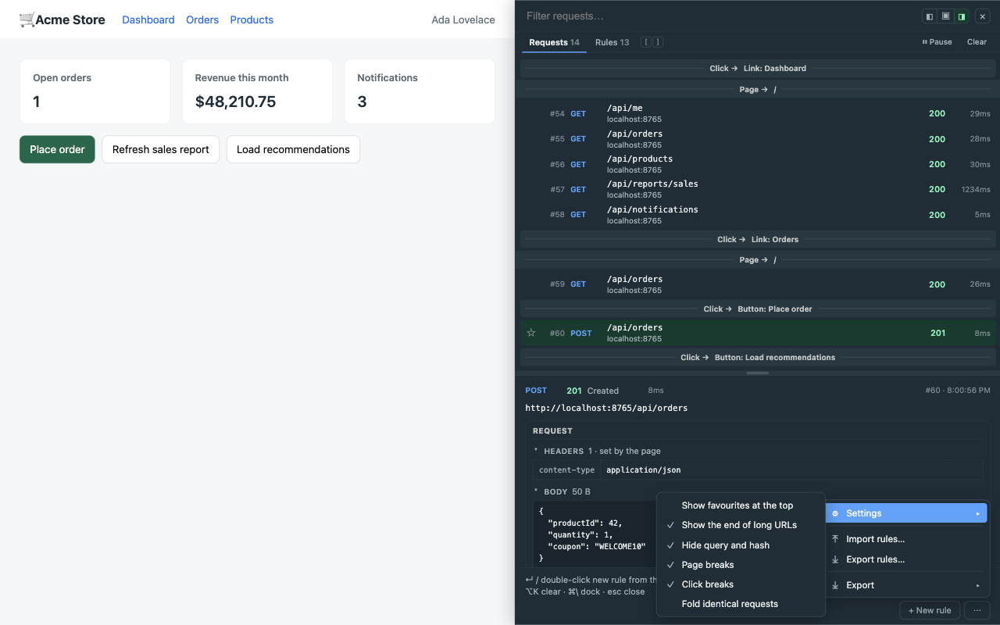

<h1 align="center">TangiRay</h1>

See, pause and rewrite a tab's API calls, on any site.

TangiRay is a [TangiTweak](https://github.com/tangistudio/TangiTweak) script. Press **⌘'** (Ctrl+' elsewhere) on any page to open it.

## Setup

1. Install [TangiTweak](https://github.com/tangistudio/TangiTweak) in your browser.
2. Click **Install with TangiTweak** above and confirm. Updates come from this repository.

To work on it locally, add this folder as a tweak in TangiTweak (the entry point is `index.ts`).

## The request list

Every `fetch`/XHR call in the tab, kept across navigations and reloads.

- **Inspect:** hover or arrow through requests to see each one in the details panel. **Click** a request to pin it there while you move on (click again or Esc to unpin).
- **Timeline:** page URL changes (with `#` fragments) and clicks on controls show as breaks; gaps of 5 s or more are marked.
- **Tidy up:** identical requests fold into one row; favourites can stay at the top.
- **Make a rule:** ↵ or double-click a request.

## Rules

A rule matches a [URL pattern](https://developer.mozilla.org/docs/Web/API/URL_Pattern_API) (`https://example.com/api/:team/items/*`, or `/api/*` on any origin), plus optionally the method, query params and request body.

| Action | What it does |
|---|---|
| **Pause request** | Hold it to send it as is or edited, answer it on the spot, or block it. |
| **Pause response** | Hold it to edit it before the page sees it. |
| **Mock** | Answer without sending: status, content type, body, optional delay. |
| **Delay** | Hold the request for a while; delays of matching rules add up. |
| **Hide / Favourite / Fold** | Only change the list. |

Tick **Remember** on a paused request or response to have its rule do the same from then on, without pausing. Among rules that change something, the first match decides.

## The ⋯ menu

- **Settings**
  - **Show favourites at the top** (on by default)
  - **Show the end of long URLs**: cut long URLs at the start, so IDs and query stay visible
  - **Hide query and hash**: show URLs as their path only (hover for the full URL)
  - **Page breaks**, **Click breaks** (input values are never recorded)
  - **Fold identical requests**: same method, URL and body; fold rules apply either way
- **Plugins**: each plugin for the page, with its on/off switch and its own switches
- **Import rules… / Export rules…** as JSON
- **Export**: the listed requests, or the one in the details panel, as HAR

## Plugins

Plugins add knowledge of a particular site, on its pages only. Switch one off in **⋯ → Plugins**, or unplug it by removing its line in [`index.ts`](index.ts). These are included:

| Plugin | What it adds |
|---|---|
| **Atlas: org, project and cluster names** | Names in place of ids in URLs, from Atlas' Redux store and API responses; other ids labelled by kind (after `groups/`, `orgId=`…). Folds away a few rarely useful Atlas headers. |
| **Atlas: Data Explorer commands (CCS)** | Data Explorer's MongoDB commands as `CCS` rows, e.g. `find demo.orders · OK · 20 documents in first batch · 42ms`, with the full command and reply documents in the details. |
| **Atlas: analytics Segment events** | Segment/Heliotrope calls (`api.blue.mongodb.com`) decoded above the request body. |

The Atlas plugins work on Atlas dev, QA, prod and `localhost:8080`.

More on CCS

Data Explorer (Compass Web) doesn't query clusters over HTTP. It sends MongoDB wire-protocol messages through one WebSocket to Atlas' Cluster Connection Service (`wss://cluster-connection.cloud.mongodb.com/ccs/<projectId>`); the plugin reads that WebSocket in the page.

- Handshakes, authentication and heartbeats are hidden unless **CCS handshakes, auth and heartbeats** is on.
- Hide, fold and favourite rules work on CCS rows (their URLs look like `mongodb://host:27017/demo/orders?command=find`); other rules and HAR export cover HTTP only.
- zlib-compressed messages are decoded; snappy and zstd ones are listed but not decoded.
- Documents stay in the page's memory and are decoded only when shown. Switching the plugin off drops them.

Writing a plugin

The interface is in [`plugin.ts`](plugin.ts); each plugin sets the pages it works on. A plugin can:

- patch more of the page (e.g. a WebSocket) and add its own log entries, with their own rows and details;
- read the page's JSON responses, and answer the palette's calls from the page's memory;
- name entities in URLs, and recognise unknown ids by the word before them;
- add switches to **⋯ → Plugins**, sections to a request's details, minor headers and CSS.

## Settings

| Setting | Default | |
|---|---|---|
| `shortcut` | `Mod+'` | Opens TangiRay. |
| `pages` | every `http`/`https` page | Where TangiRay runs. |

## Privacy

Rules and HAR exports can contain URLs, headers, request bodies and identifiers from the pages you use, and click breaks show the labels of the controls you click. Review exports before sharing.
